# 못난이마켓 최종 ERD

> 최종 갱신: 2026-10-28
> 기준: `supabase/migrations`의 `202610080001` ~ `202610270002`
> 상태: 인증·상품·리뷰·장바구니·주문·쿠폰·체험 예약 스키마 반영

이 문서는 제출 시점의 논리 ERD입니다. 실제 생성·제약·인덱스·RLS의 최종 기준은 항상 [`supabase/migrations`](../supabase/migrations)입니다. 기존 `erd.png`는 주문 기능 확장 전의 과거 참고 이미지이므로 최신 구조 확인에는 아래 Mermaid 관계도를 사용합니다.

## 1. 전체 관계도

```mermaid
erDiagram
    auth_users ||--o| profiles : "회원 프로필"
    auth_users o|--o| app_users : "서비스 계정 연결"
    auth_users ||--o| admin_registrations : "관리자 가입 신청"
    auth_users ||--o{ cart_items : "장바구니 소유"
    auth_users ||--o{ wishlist_items : "찜 소유"
    auth_users ||--o{ orders : "주문 소유"
    auth_users ||--o{ user_coupons : "쿠폰 소유"
    auth_users ||--o{ product_reviews : "리뷰 작성"

    app_users ||--o{ revoked_tokens : "로그아웃 토큰 차단"
    app_users ||--o{ experience_reservations : "체험 예약 소유"

    vegetables ||--o{ products : "상품 분류"
    products ||--o| product_images : "DB 상품 이미지"
    products ||--o{ cart_items : "장바구니 상품"
    products ||--o{ wishlist_items : "찜 상품"
    products ||--o{ order_items : "주문 상품"
    products ||--o{ recipe_products : "레시피 연관 상품"
    products ||--o{ product_reviews : "상품 리뷰"
    product_reviews ||--o{ product_review_images : "리뷰 이미지"

    recipes ||--o{ recipe_products : "레시피 상품 연결"

    orders ||--|{ order_items : "주문 스냅샷"
    orders ||--o| refund_requests : "환불 신청"
    coupon_campaigns ||--o{ user_coupons : "쿠폰 발급"
    experiences ||--o{ experience_sessions : "체험 회차"
    experience_sessions ||--o{ experience_reservations : "회차 예약"

    auth_users {
        uuid id PK "Supabase Auth"
        text email
    }
    app_users {
        uuid id PK "JWT sub"
        text email UK
        text username UK
        text password_hash
        text role "user/admin"
        boolean is_active
        uuid supabase_user_id FK,UK
        timestamptz created_at
    }
    profiles {
        uuid id PK,FK "auth.users.id"
        text nickname
        text recipient_name
        text recipient_phone
        text postal_code
        text address
        text address_detail
        timestamptz created_at
        timestamptz updated_at
    }
    revoked_tokens {
        text jti PK
        uuid user_id FK
        timestamptz expires_at
        timestamptz revoked_at
    }
    admin_registrations {
        uuid id PK,FK "auth.users.id"
        text username UK
        text email UK
        text display_name
        text status "pending/approved/rejected"
        timestamptz created_at
    }
    vegetables {
        text id PK
        text name
        text category
        text description
        text storage_guide
        text prep_guide
        text season
        text image_path
        timestamptz created_at
    }
    products {
        text id PK
        text vegetable_id FK
        text name
        text tagline
        integer price
        integer original_price
        text unit
        text ugly_reason
        text description
        text condition_note
        text farm_name
        text farm_region
        text farm_story
        text image_path
        integer stock
        numeric rating
        integer review_count
        boolean is_seasonal
        boolean is_featured
        boolean is_active
        timestamptz created_at
        timestamptz updated_at
    }
    product_images {
        text product_id PK,FK
        bytea body
        timestamptz updated_at
    }
    product_reviews {
        uuid id PK
        uuid user_id FK
        text product_id FK
        integer rating "1~5"
        text content
        integer image_count
        timestamptz created_at
        timestamptz deleted_at
        text deletion_reason
    }
    product_review_images {
        uuid review_id PK,FK
        integer position PK
        bytea body
    }
    recipes {
        text id PK
        text name
        text description
        integer cook_time_min
        text difficulty
        integer servings
        jsonb ingredients
        jsonb steps
        jsonb vegetables
        text source_url
        text source_name
        text image_path
        timestamptz created_at
    }
    recipe_products {
        text recipe_id PK,FK
        text product_id PK,FK
    }
    recipe_view_events {
        text recipe_id PK "의도적으로 FK 없음"
        uuid visitor_id PK
        timestamptz viewed_hour PK
        timestamptz viewed_at
    }
    cart_items {
        uuid id PK
        uuid user_id FK
        text product_id FK
        integer quantity "1~99"
        timestamptz created_at
        timestamptz updated_at
    }
    wishlist_items {
        uuid id PK
        uuid user_id FK
        text product_id FK
        timestamptz created_at
    }
    orders {
        uuid id PK
        uuid user_id FK
        uuid request_key "사용자별 멱등 키"
        text status
        bigint total_amount
        integer shipping_fee
        text payment_method
        text recipient_name
        text recipient_phone
        text postal_code
        text address
        text address_detail
        timestamptz paid_at
        timestamptz created_at
        timestamptz updated_at
    }
    order_items {
        uuid order_id PK,FK
        text product_id PK,FK
        text product_name "주문 시점 스냅샷"
        text product_unit
        integer unit_price
        integer quantity
    }
    refund_requests {
        uuid order_id PK,FK
        text reason
        text status "requested/approved/rejected"
        timestamptz created_at
        timestamptz reviewed_at
    }
    coupon_campaigns {
        text id PK
        text name
        text discount_type
        integer discount_value
        integer minimum_amount
        integer maximum_discount
        timestamptz starts_at
        timestamptz ends_at
        integer valid_days
        text_array eligible_vegetables
        boolean first_purchase_only
        boolean daily
        boolean is_active
    }
    user_coupons {
        uuid id PK
        uuid user_id FK
        text campaign_id FK
        date issuance_day
        timestamptz issued_at
        timestamptz expires_at
        timestamptz used_at
    }
    experiences {
        text id PK
        text title
        text description
        text farm_name
        text region
        integer fee
        text image_path
        boolean is_active
        timestamptz created_at
    }
    experience_sessions {
        uuid id PK
        text experience_id FK
        timestamptz starts_at
        integer capacity
        text status "open/closed"
    }
    experience_reservations {
        uuid id PK
        uuid session_id FK
        uuid user_id FK "app_users.id"
        integer headcount
        text status "reserved/cancelled"
        timestamptz created_at
        timestamptz cancelled_at
    }
```



`recipe_view_events.recipe_id`는 레시피 데이터 소스가 DB와 정적 카탈로그 사이에서 바뀔 수 있어 의도적으로 FK를 두지 않았습니다. `products.rating`과 `products.review_count`는 리뷰 변경 트리거가 집계합니다.

## 2. 사용자 식별 규칙

| 저장소       | 역할                                          | 참조하는 테이블                                                                                                |
| ------------ | --------------------------------------------- | -------------------------------------------------------------------------------------------------------------- |
| `auth.users` | Supabase OAuth와 기존 화면의 공통 사용자 원본 | `profiles`, `cart_items`, `wishlist_items`, `orders`, `user_coupons`, `product_reviews`, `admin_registrations` |
| `app_users`  | FastAPI 로그인 정보, 역할, 활성 상태          | `revoked_tokens`, `experience_reservations`                                                                    |

서비스 사용자 생성 절차는 한 트랜잭션에서 같은 UUID로 다음 행을 만듭니다.

```text
auth.users.id
  = app_users.id
  = app_users.supabase_user_id
  = profiles.id
  = JWT sub
```

따라서 FastAPI JWT의 `sub`로 기존 Supabase FK 테이블과 FastAPI 전용 테이블의 소유권을 동일하게 검사할 수 있습니다. DB 제약상 `app_users.supabase_user_id`는 nullable이지만 서비스에서 생성하는 정상 사용자는 동일 UUID 연결을 보장합니다.

## 3. 핵심 제약과 트랜잭션

- 장바구니: 사용자·상품 조합은 1행, 수량은 `1~99`입니다.
- 장바구니 병합: 재시도와 다중 탭에서도 결과가 같도록 기존 수량과 비회원 수량 중 큰 값을 사용합니다.
- 주문: `(user_id, request_key)`가 중복 주문을 막고, 주문·주문 항목 저장과 장바구니 정리를 한 트랜잭션으로 처리합니다.
- 주문 스냅샷: 상품명·단위·가격·배송지는 주문 시점 값을 복사해 이후 원본 변경의 영향을 받지 않습니다.
- 재고: 주문 시 서버가 현재 가격·판매 상태·재고를 검증하고 차감합니다.
- 리뷰: 사용자·상품당 1건이며 구매 이력을 확인합니다. 소프트 삭제와 관리자 영구 삭제를 구분합니다.
- 체험 예약: 같은 사용자·같은 회차의 활성 예약은 1건이며 정원·접수 상태·취소 기한을 서비스에서 검사합니다.
- 로그아웃: JWT `jti`를 `revoked_tokens`에 저장해 만료 전 재사용도 401로 차단합니다.

## 4. 마이그레이션 이력

| 범위                                 | 주요 파일                                                     |
| ------------------------------------ | ------------------------------------------------------------- |
| 기본 프로필·상품·레시피·구매         | `202610080001` ~ `202610130001`                               |
| 체험·회차·예약                       | `202610250001_experiences.sql`                                |
| 관리자 가입 신청                     | `202610250002_admin_registrations.sql`                        |
| FastAPI 계정·차단 토큰·아이디 로그인 | `202610260001_accounts.sql`, `202610260003_app_usernames.sql` |
| 체험 예약 사용자 FK 정리             | `202610260002_experience_reservation_user_fk.sql`             |
| 리뷰·재고·상품명·DB 이미지           | `202610260004` ~ `202610260007`                               |
| 레시피 조회·리뷰 집계                | `202610270001`, `202610270002`                                |

적용 여부는 파일 존재만으로 판단하지 않고 실제 대상 DB의 테이블·컬럼·인덱스를 확인합니다. 공유 DB 마이그레이션은 담당자 확인 없이 다시 실행하거나 롤백하지 않습니다.

## 5. 담당 도메인 경계

| 도메인                | 주요 테이블                                                                                              | 담당      |
| --------------------- | -------------------------------------------------------------------------------------------------------- | --------- |
| 회원·인증·마이페이지  | `auth.users`, `app_users`, `profiles`, `revoked_tokens`, `admin_registrations`                           | 지나      |
| 상품·찜·리뷰          | `vegetables`, `products`, `product_images`, `wishlist_items`, `product_reviews`, `product_review_images` | 서현      |
| 장바구니·주문         | `cart_items`, `orders`, `order_items`, `refund_requests`                                                 | 영우      |
| 체험 예약             | `experiences`, `experience_sessions`, `experience_reservations`                                          | 형준      |
| 레시피·쿠폰·공통 연결 | `recipes`, `recipe_products`, `recipe_view_events`, `coupon_campaigns`, `user_coupons`                   | 통합 관리 |

공통 사용자 UUID와 API 계약은 도메인 간 연결점이며, 다른 담당자의 테이블이나 공통 파일을 변경할 때는 PR에 영향 범위를 명시합니다.
