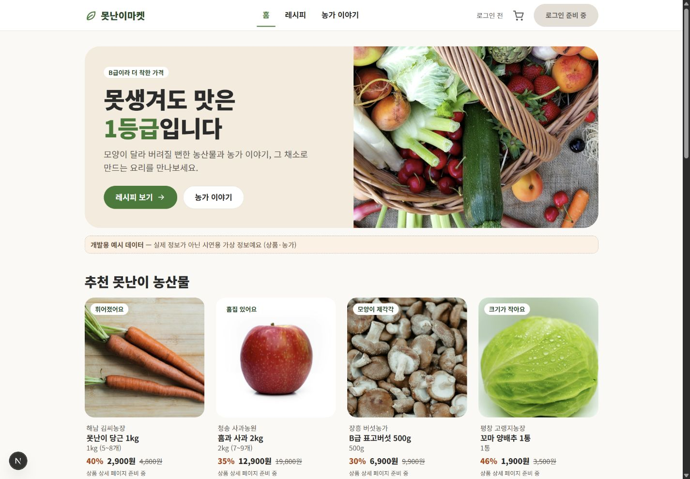
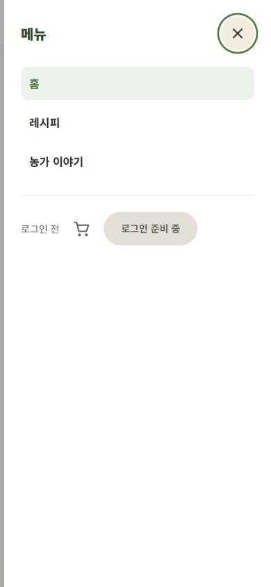

# C 공통 레이아웃·Header·Footer·모바일 메뉴

담당: C 이상재 / 작업일: 2026-10-12 / Redmine #11.

## 구현

최신 main의 A 디자인 규칙과 공통 컴포넌트를 이어서 구현했습니다. 색·간격·버튼은 `docs/design-guide.md`와 `globals.css` 토큰을 사용합니다. 본문은 A의 화면을 보존하고 layout에 NavigationProvider를 연결했습니다.

- PC는 로고·주요 메뉴·개인 상태, 1024px 미만에서는 모바일 메뉴를 표시합니다.
- 모바일 메뉴는 native dialog로 구현했습니다. 열기·닫기·Escape·링크 이동·경로 변경·PC 폭 전환 시 닫히며, 닫은 뒤 열기 버튼으로 포커스를 돌리고 배경 스크롤을 복구합니다.
- `/api/navigation`은 검증된 로그인 사용자 본인의 닉네임과 장바구니 상품 **총 수량**을 읽습니다. 같은 상품을 1개씩 다시 담아도 뱃지가 1씩 증가하고, 수량 변경·삭제 후에도 현재 합계를 표시합니다. 입력 user_id는 사용하지 않고 개인 응답은 private/no-store·Vary Cookie로 캐시를 차단합니다.
- Provider는 경로 이동·창 포커스·인증 이벤트 때 다시 조회합니다. 계정 변경과 로그아웃 때 기존 개인정보를 지우고 이전 요청을 취소합니다. 실패는 재시도로 표시하며 성공한 로그인 상태나 0개 장바구니로 꾸미지 않습니다.
- `useNavigation().refresh()`를 장바구니 변경 성공 후 호출하면 헤더 숫자를 다시 확인합니다.
- `signOut()`의 기존 이동 동작은 유지합니다. 헤더는 `signOut(false)`의 성공 결과를 받은 후 Context 초기화와 홈 이동을 수행하고, 실패 시 오류 문구를 표시합니다.
- 로그인·장바구니·마이페이지 화면은 아직 없으므로 `src/lib/routes.ts`의 personalPages를 false로 유지합니다. 화면을 구현한 뒤 true로 바꾸어 이동을 활성화합니다. 현재는 준비 중 상태를 표시합니다.

## 검증

- 테스트 16개·typecheck·lint 통과.
- 320px·390px·768px·1440px에서 메뉴/헤더 확인, 가로 넘침 없음.
- Escape 닫기와 열기 버튼 포커스 복귀, 홈 → 메뉴 → 레시피 이동, PC 폭 전환 시 메뉴 닫기·스크롤 잠금 해제 확인.
- 실제 Supabase 비로그인 세션에서 navigation API의 user=null·cartCount=0과 개인 캐시 차단 확인.
- `node scripts/check-navigation.mjs http://localhost:3102`로 비로그인 응답·user_id 주입 무시·캐시 차단을 재검증할 수 있습니다.
- 명시적인 USE_MOCK_DATA=true로 프로덕션 빌드 통과. .env.local은 수정하지 않았습니다.

## 남은 실제 연동 검증

현재 공유 DB에는 A의 레시피 컬럼 `source_url`이 없어 기본 Supabase 모드의 홈 조회가 실패합니다. A의 `202610110001_verified_recipe_metadata.sql` 적용 여부와 seed를 확인해야 합니다. 화면 검증은 명시적인 Mock 콘텐츠 모드이며, 실제 DB 연결 완료로 기록하지 않습니다.

실제 계정의 닉네임·장바구니 수·로그아웃·계정 전환은 로그인(#12)과 장바구니(#14) 화면 연결 후 검증합니다. 실제 휴대폰 검수도 별도입니다. 따라서 Redmine #11의 상태는 진행으로 유지하고 전체 완료 조건을 충족한 뒤 완료 처리합니다.

2026-10-12 도전 실습 B 검증: 같은 상품을 1개씩 두 번 담아 헤더 뱃지가 0 → 1 → 2로 증가하는 것을 실제 로그인 화면에서 확인했습니다. 테스트 상품을 정리해 원래 빈 장바구니 상태로 복원했습니다. 총 수량·빈 목록·비로그인·조회 실패를 자동 테스트로 확인합니다.
